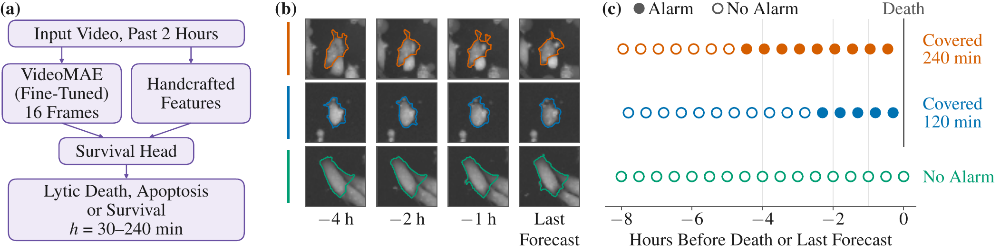
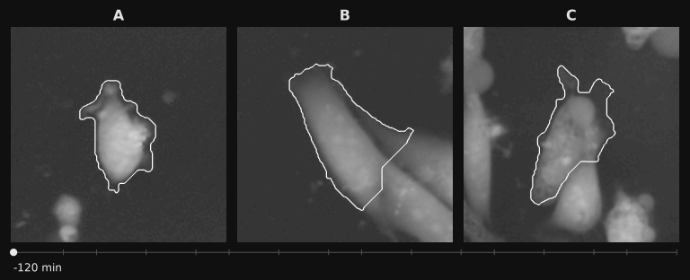

[](https://doi.org/10.5281/zenodo.23883611) [](docs/REPRODUCE.md#installation) [](LICENSE)

**Cell movies usually show you a death after it happened. DeadAhead calls it before it happens.** 🔮

Every 30 min, from the past two hours of quantitative phase video, DeadAhead forecasts each cell's death by apoptosis or
lytic death, 30 to 240 min ahead. Cells whose fate was never seen stay in.

*DeadAhead: Forecasting when and how a cell will die from quantitative phase video.* M. Koochali, N. Khalid, A. Dengel,
S. Ahmed. Under review.

📚 [Full results, S1 to S8](docs/SUPPLEMENT.md) · ✅ [Check any claim](docs/REPRODUCE.md#which-command-checks-which-claim) · 🧠 [Models](https://zenodo.org/records/23883153) · 💾 [Predictions](https://zenodo.org/records/23883611)

## ⚡ The 30-second version

| | On held-out line-by-treatment groups | Compare with |
|---|---|---|
| 🎯 **0.322** | Lytic AUPRC at 30 min, 13 times chance. Apoptosis: 0.213 (chance 0.012) | Best image baseline 0.254, ahead in 8 of 9 groups |
| 🚨 **66.2%** | Lytic deaths with the alarm on at every forecast of the final hour, at training-only thresholds | Elapsed-time control 10.5% |
| 🔭 **0.482** | Lytic AUPRC at 240 min, from the same model | Elapsed time 0.217 |
| ⏩ **0.175** | Lytic AUPRC 60 to 120 min ahead, with the next hour's deaths left out (post hoc) | Chance 0.052, elapsed time 0.071, DINOv2 + handcrafted 0.162 |



*Three held-out cells. Filled dots: alarm on. The alive cell's time runs to its last forecast. Examples illustrate the
method and are not evidence. Images: CellDeathDetect (Vicar et al., 2020), CC BY 4.0.*

## 🕵️ Beat the model

Real held-out cells. Each clip is the two hours of video that DeadAhead's video model read at one forecast. Two of these
cells die within the next two hours and one lives on. Can you spot the survivor?



*Cropped, upscaled, outline added. Images: CellDeathDetect (Vicar et al., 2020), CC BY 4.0.*

<details>
<summary>👀 Show the answer</summary>

**B lives** to the end of its movie, and its alarm stayed off. **A and C die by lytic death** about two hours after the
clip ends, and DeadAhead's alarm was already on for both.

These are the three cells of Figure 1, picked by a fixed rule to show the method, so this is not a score. The alarm means
the 30-min lytic risk passed the training-only threshold. The handcrafted features read more than these clips show.

</details>

## 🧩 What the paper had no room for

| | Question | Quick answer | Full |
|---|---|---|:---:|
| 🔭 | Does it hold at every horizon? | Lytic AUPRC 0.402 at 120 min and 0.482 at 240 min, concordance 0.900 to 0.784. IPA, calibration and thresholds for both routes | [S1](docs/SUPPLEMENT.md#s1-fixed-horizon-forecasts) |
| 🧫 | Group by group? | Lead over the best image baseline runs from −0.059 to +0.172. Without PNT1A bp: +0.055, 7 of 8 | [S2](docs/SUPPLEMENT.md#s2-per-group-differences) |
| 🚨 | How good are the warnings? | Median warning 89 min, elapsed time 3 min. At target rate 0.4, the alarm is on through the final hour before 83.0% of lytic deaths | [S3](docs/SUPPLEMENT.md#s3-warnings-in-detail) |
| 🔧 | What does fine-tuning add, and what breaks the model? | Fine-tuning adds +0.064 on lytic death (7 of 9) and +0.084 on apoptosis (9 of 9). Hide the cell, shuffle the frames or repeat the last frame, and VideoMAE falls from 0.318 to 0.079, 0.110 and 0.061 | [S4](docs/SUPPLEMENT.md#s4-fine-tuning-and-test-time-changes) |
| 🎞️ | Is the gain from the video features? | VideoMAE alone reaches 0.318, +0.065 over DINOv2 + handcrafted (8 of 9). Same head, same handcrafted features: +0.079 over DINOv2 features (9 of 9) | [S5](docs/SUPPLEMENT.md#s5-videomae-alone-the-same-head-comparison-and-elapsed-time) |
| 🧪 | Does it survive stress tests? | Gap analysis, complete follow-up and a label audit. In a censoring experiment, keeping censored cells beats deleting them (+0.042, 8 of 9) and ties counting them as negatives at 30 min | [S6](docs/SUPPLEMENT.md#s6-gap-analysis-sensitivity-analyses-censoring-and-label-audit) |
| 🍺 | Does the recipe travel? | Budding yeast, exploratory: 0.0488 against chance 0.0072 over 7 held-out positions | [S7](docs/SUPPLEMENT.md#s7-exploratory-probe-yeast-death) |
| 🔍 | Is it just timing? | Post hoc, scored within each hour of imaging, the lytic lead is +0.073 in 8 of 9 groups. At a matched alarm rate: 72.8% against 63.5%, 7 of 9 | [S8](docs/SUPPLEMENT.md#s8-post-hoc-analyses) |

## 🛡️ Why you can trust the numbers

- 🧱 **Whole groups held out.** Leave-one-group-out over 9 groups, and no image encoder saw the held-out group.
- ⏳ **Past only.** A forecast reads the last two hours and nothing later.
- 🎚️ **Thresholds from training groups only,** fixed before the held-out group is scored.
- 🕰️ **An elapsed-time control,** so a score that only tracks imaging time cannot pass as a forecaster.
- 🪦 **No fake negatives.** A forecast whose follow-up ends inside the horizon is never scored as a negative.
- 🏷️ **Honest labels.** Our rule, fixed before scoring: a lead of at least 0.02 with the same sign in at least 7 of 9 groups. Post hoc work says post hoc.

The leakage guards are [tests you can run](docs/METHOD.md#what-protects-the-result). Known limits are in the paper and in [S6](docs/SUPPLEMENT.md#s6-gap-analysis-sensitivity-analyses-censoring-and-label-audit).

## 🚀 Try it in 5 minutes

Table 1 on a CPU, with no GPU and no raw movies (Python 3.10 or newer):

```bash
git clone https://github.com/Mahdi-Koochali/DeadAhead.git && cd DeadAhead
python3 -m venv .venv && . .venv/bin/activate && pip install -e .
export DEADAHEAD_DATA="$PWD/data"
curl -L -o data/deadahead_bundle_v1.zip "https://zenodo.org/records/23883611/files/deadahead_bundle_v1.zip?download=1"
unzip -q data/deadahead_bundle_v1.zip -d data
deadahead reproduce --part table1
```

You should see the paper's numbers land 🎉

```text
method                                       lytic  apoptosis  lytic (8)  apopt. (8)
chance (prevalence)                          0.024      0.012      0.023       0.008
deadahead                                    0.322      0.213      0.324       0.195
dinov2_handcrafted|refit                     0.254      0.180      0.268       0.155
```

## 🗺️ Where everything lives

| I want to... | Go to |
|---|---|
| See every table, figure and S1 to S8 | [docs/SUPPLEMENT.md](docs/SUPPLEMENT.md) |
| Check a claim of the paper with one command | [docs/REPRODUCE.md](docs/REPRODUCE.md) |
| Read the method, the safeguards and the closest work | [docs/METHOD.md](docs/METHOD.md) |
| Get the models and data, or retrain everything | [docs/TRAINING.md](docs/TRAINING.md), [model card](docs/MODEL_CARD.md), [data card](docs/DATA.md), [weights](docs/WEIGHTS.md) |
| Find a file | [docs/LAYOUT.md](docs/LAYOUT.md) |

<details>
<summary>📄 Abstract</summary>

Forecasting when and how a cell will die would let biologists study cells while still alive, to learn why some cancer
cells survive a drug that kills their neighbours. Existing forecasts say whether a cell will die, not when. Every 30
min, DeadAhead, a fine-tuned VideoMAE with handcrafted features and a competing-risks survival head, forecasts each
cell's death by apoptosis or lytic death within 30 to 240 min from its past two hours of quantitative phase
video, keeping cells whose fate was never seen. On held-out line-by-treatment groups of three prostate cell lines, it
reached a 30-min lytic macro AUPRC of 0.322, thirteen times chance, against 0.254 for the best image
baseline, DINOv2 + handcrafted (ahead in 8 of 9 groups). With training-only thresholds,
DeadAhead's alarm was on at every forecast of the final hour before 66.2% of lytic deaths, far more than
an elapsed-time control. Both routes stayed far above chance out to 240 min.

</details>

<details>
<summary>📝 Citation</summary>

```bibtex
@misc{koochali2026deadahead,
  title  = {{DeadAhead}: Forecasting when and how a cell will die from quantitative phase video},
  author = {Koochali, Mohammadmahdi and Khalid, Nabeel and Dengel, Andreas and Ahmed, Sheraz},
  year   = {2026},
  note   = {Under review}
}
```

Please also cite the CellDeathDetect dataset (Vicar et al., 2020) and VideoMAE (Tong et al., 2022).

</details>

📜 Code: MIT. Predictions and figures: CC BY 4.0. Fine-tuned VideoMAE weights: CC BY-NC 4.0, inherited from
[VideoMAE](https://huggingface.co/MCG-NJU/videomae-large). [Every licence](docs/LAYOUT.md#licences).
