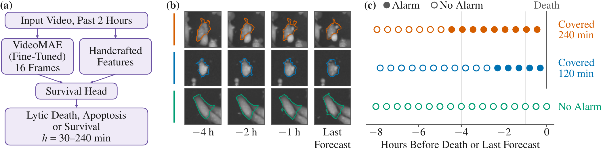
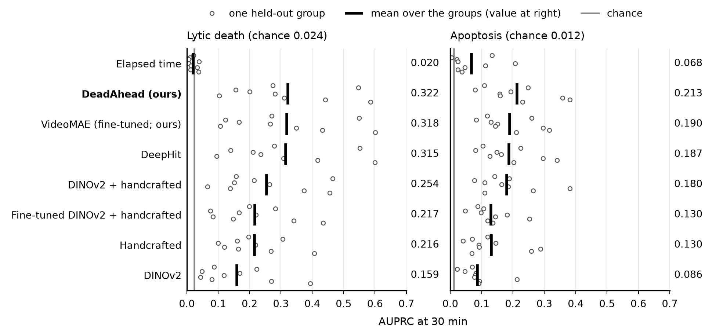
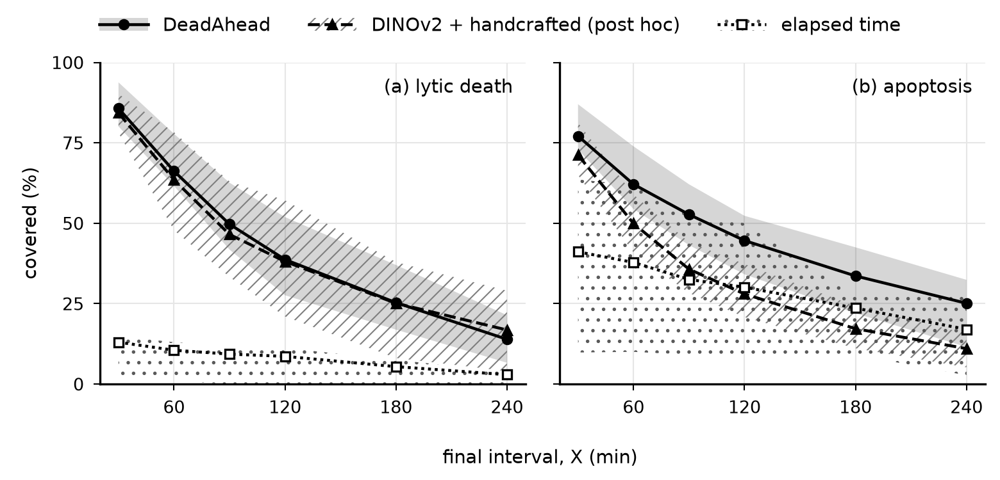
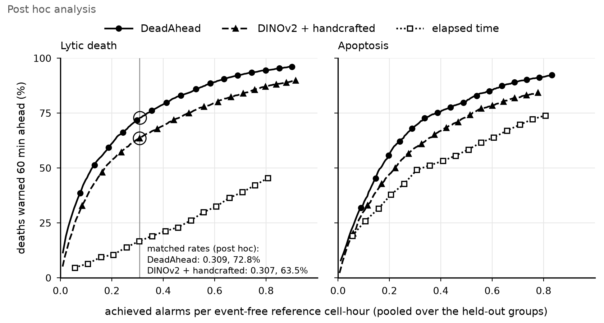
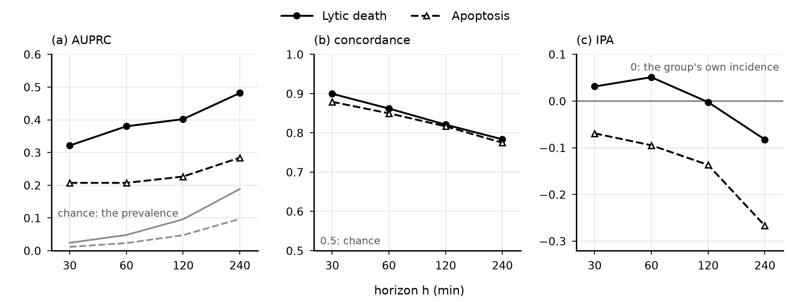
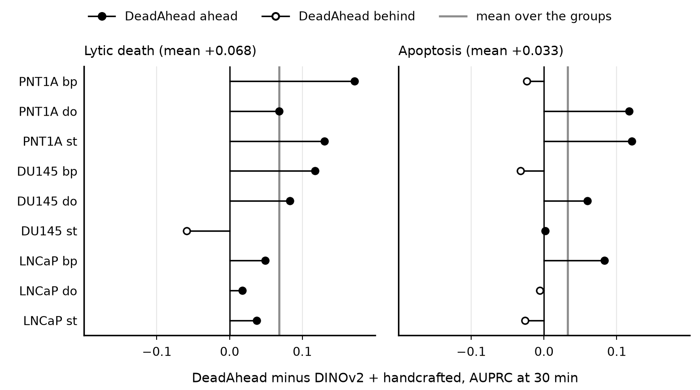
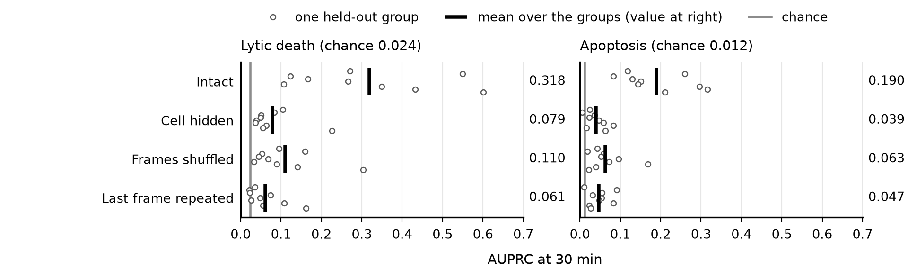
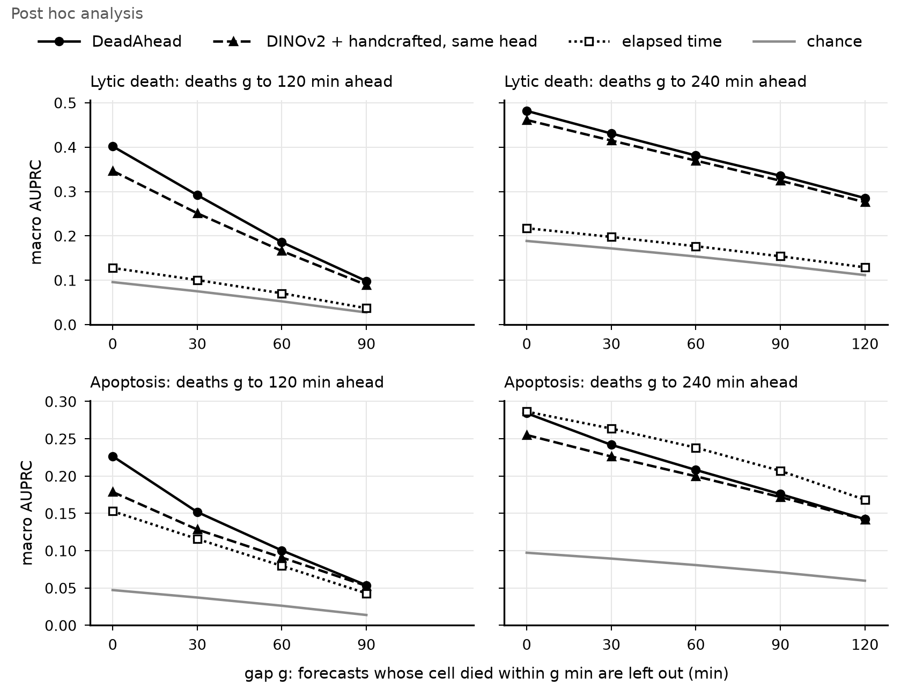
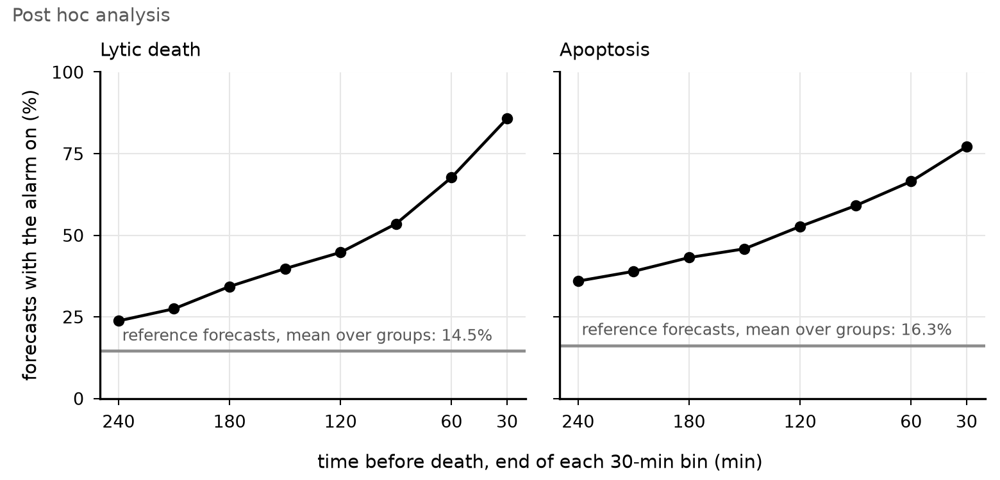

# Full results and supplement S1 to S8

[Back to the README](../README.md)

- [S1. Fixed-horizon forecasts](#s1-fixed-horizon-forecasts)
- [S2. Per-group differences](#s2-per-group-differences)
- [S3. Warnings in detail](#s3-warnings-in-detail)
- [S4. Fine-tuning and test-time changes](#s4-fine-tuning-and-test-time-changes)
- [S5. VideoMAE alone, the same-head comparison and elapsed time](#s5-videomae-alone-the-same-head-comparison-and-elapsed-time)
- [S6. Gap analysis, sensitivity analyses, censoring and label audit](#s6-gap-analysis-sensitivity-analyses-censoring-and-label-audit)
- [S7. Exploratory probe: yeast death](#s7-exploratory-probe-yeast-death)
- [S8. Post hoc analyses](#s8-post-hoc-analyses)

**From quantitative phase video of held-out groups, DeadAhead forecasts when and how a cell will die: it ranks lytic deaths
at 13 times chance (macro AUPRC 0.322 against 0.024) and covers the final hour before 66.2% of them, with alarm
thresholds set on training groups only.**

Code and supplement S1 to S8 for the paper *DeadAhead: Forecasting when and how a cell will die from quantitative phase video*
(M. Koochali, N. Khalid, A. Dengel, S. Ahmed; under review), with links to the predictions and models on Zenodo.

Forecasting when and how a cell will die would let biologists study cells while still alive, to learn why some cancer
cells survive a drug that kills their neighbours. No existing image-based forecast says when a cell will die while keeping cells of unknown fate. Every 30
min, DeadAhead, a fine-tuned VideoMAE with handcrafted features and a competing-risks survival head, forecasts each
cell's death by apoptosis or lytic death within 30 to 240 min from its past two hours of quantitative phase
video, keeping those cells. On held-out line-by-treatment groups of three prostate cell lines, it
reached a 30-min lytic macro AUPRC of 0.322, thirteen times chance, against 0.254 for the best image
baseline, DINOv2 + handcrafted (ahead in 8 of 9 groups). With training-only thresholds,
DeadAhead's alarm was on at every forecast of the final hour before 66.2% of lytic deaths, far more than
an elapsed-time control. Both routes stayed far above chance out to 240 min.

**Figure 1.** DeadAhead. (a) Every 30 min, VideoMAE (fine-tuned) features of the past 2 h and handcrafted features
feed the survival head, giving the probability of lytic death, apoptosis or survival within h = 30 to 240 min.
(b) Input crops (80.5 µm wide) of three held-out LNCaP do cells: orange, early coverage; blue, the group's
median coverage; green, alive with no alarm. (c) Each dot is one
forecast, filled when its 30-min lytic risk exceeded the training-only threshold; the alive cell's time runs to its last
forecast. Cells LNCaP_do_4:49, LNCaP_do_3:10 and LNCaP_do_2:8, seed 2601562; the orange cell's alarm stayed on through its
last 270 min, which counts as covered over its final 240 min on the X grid of [Figure 2](#figure-2). Images:
CellDeathDetect (Vicar et al., 2020), CC BY 4.0.

## At a glance

| Method | Lytic AUPRC ([Table 1](#table-1)) | Apoptosis AUPRC ([Table 1](#table-1)) | Lytic deaths covered, final 60 min ([Figure 2](#figure-2)) | Details |
|---|:---:|:---:|:---:|---|
| **DeadAhead (ours)** | **0.322** | **0.213** | **66.2%** (achieved rate 0.24) | [S1](#s1-fixed-horizon-forecasts), [S3](#s3-warnings-in-detail) |
| DeadAhead, target 0.26, at a matched alarm rate (post hoc) | | | **72.8%** (achieved rate 0.309) against 63.5% for DINOv2 + handcrafted (achieved rate 0.307); ahead in 7 of 9 groups | [S8](#s8-post-hoc-analyses) |
| VideoMAE (fine-tuned; ours) | 0.318 | 0.190 | | [S4](#s4-fine-tuning-and-test-time-changes), [S5](#s5-videomae-alone-the-same-head-comparison-and-elapsed-time) |
| DeepHit | 0.315 | 0.187 | | [S5](#s5-videomae-alone-the-same-head-comparison-and-elapsed-time) |
| DINOv2 + handcrafted | 0.254 | 0.180 | 63.5% (achieved rate 0.31; post hoc) | [S2](#s2-per-group-differences), [S8](#s8-post-hoc-analyses) |
| Fine-tuned DINOv2 + handcrafted | 0.217 | 0.130 | | [S5](#s5-videomae-alone-the-same-head-comparison-and-elapsed-time) |
| Handcrafted | 0.216 | 0.130 | | [S6](#s6-gap-analysis-sensitivity-analyses-censoring-and-label-audit) |
| DINOv2 | 0.159 | 0.086 | | [S5](#s5-videomae-alone-the-same-head-comparison-and-elapsed-time) |
| Elapsed time (control) | 0.020 | 0.068 | 10.5% (achieved rate 0.21) | [S5](#s5-videomae-alone-the-same-head-comparison-and-elapsed-time), [S6](#s6-gap-analysis-sensitivity-analyses-censoring-and-label-audit) |
| Chance | 0.024 | 0.012 | | [Table 1](#table-1) |

AUPRC is the area under the precision-recall curve at 30 min, as a mean over the 9 held-out groups. Warnings
use training-only thresholds at a target of 0.2 alarms per event-free reference cell-hour; the achieved
rates are pooled over the held-out groups, and the shares are means over the groups. Warnings were scored for the methods
of [Figure 2](#figure-2). Recomputed by `deadahead reproduce --part table1` (AUPRC), `--part warnings` and
`--part image-warnings` (warnings), and `--part alarm-rate` (the matched row).

## Main results

### Table 1

*Recomputed by `deadahead reproduce --part table1`.*

**Table 1.** Macro AUPRC at 30 min over the 9 held-out groups, with DeadAhead's lead and, in brackets, the groups
ahead (\*: meets our decision rule). Leads and multiples of chance use unrounded values. Chance: the positive rate averaged over groups ([Method in brief](METHOD.md#method-in-brief)
gives it pooled). Comparator heads are refit without the untyped-death windows (for Fine-tuned DINOv2 + handcrafted, only the head).

| Model | Lytic | Lead (groups ahead) | Apoptosis | Lead (groups ahead) |
|---|:---:|:---:|:---:|:---:|
| **DeadAhead (ours)** | **0.322** | | **0.213** | |
| VideoMAE (fine-tuned) | 0.318 | +0.004 (5) | 0.190 | +0.023 (6) |
| DeepHit | 0.315 | +0.007 (5) | 0.187 | +0.026 (7)\* |
| DINOv2 + handcrafted | 0.254 | +0.068 (8)\* | 0.180 | +0.033 (5) |
| Fine-tuned DINOv2 + handcrafted | 0.217 | +0.106 (9)\* | 0.130 | +0.083 (8)\* |
| Handcrafted | 0.216 | +0.107 (7)\* | 0.130 | +0.082 (8)\* |
| DINOv2 | 0.159 | +0.163 (9)\* | 0.086 | +0.127 (9)\* |
| Elapsed time | 0.020 | +0.302 (9)\* | 0.068 | +0.145 (7)\* |
| Chance | 0.024 | | 0.012 | |

**Figure T1: Table 1 at a glance.** The same values with the spread: each row is a model, each open dot one of the 9
held-out groups, the bar the mean over the groups, printed at the right; the grey line is chance. The values are in
[`docs/figures/data/figT1_auprc_by_method.csv`](figures/data/figT1_auprc_by_method.csv).

For lytic death the lead over DINOv2 + handcrafted ran from −0.059 to +0.172 across groups
(+0.055, 7 of 8, without PNT1A bp; per group in
[S2](#s2-per-group-differences)). Elapsed time stayed near chance for lytic death (0.020 against
0.024; [S5](#s5-videomae-alone-the-same-head-comparison-and-elapsed-time)).

### Figure 2

*Recomputed by `deadahead reproduce --part warnings` (DeadAhead, elapsed time), `--part image-warnings` (DINOv2 +
handcrafted, post hoc) and `--part alarm-rate` (the second row, post hoc).*

**Figure 2.** Alarm coverage. Share of deaths covered over their final X min, means over 9 held-out groups; bands:
interquartile range over the groups. Training-only thresholds at a target reference
alarm rate of 0.2; achieved (pooled): DeadAhead 0.24 and 0.24, DINOv2 + handcrafted (post hoc)
0.31 and 0.22, elapsed time 0.21 and 0.21 (lytic, apoptosis). Deaths
counted at X: those with a forecast in every 30-min bin up to X. The values are in
[`docs/figures/data/fig2_warnings_spread.csv`](figures/data/fig2_warnings_spread.csv) (means, ranges and
quartiles; columns `survival`: DeadAhead, `image`: DINOv2 + handcrafted, `clock`: elapsed time) and in
[S3](#s3-warnings-in-detail).

**Figure 2, second row (post hoc).** Deaths covered over their final 60 min against the achieved rate (pooled), each point a
training-only threshold on a grid fixed in advance; circles: the match. Means over the 9 held-out groups, for DeadAhead,
DINOv2 + handcrafted with its own head and elapsed time; the match is the lytic comparison
(0.309 against 0.307 pooled; [S8](#s8-post-hoc-analyses)). The values are in
[`docs/figures/data/figS8b_alarm_rate.csv`](figures/data/figS8b_alarm_rate.csv).

### Table 2

*Recomputed by `deadahead reproduce --part horizons`.*

**Table 2.** Fixed-horizon forecasts of DeadAhead, macro over all 9 held-out groups: prevalence (%), AUPRC,
concordance (C), IPA and its groups below zero, and at each horizon's own training-only threshold (target 0.2;
reference forecasts followed event-free through it) the achieved rate (mean over groups), precision and sensitivity.
Complete-movie follow-up (Table 1 labels up to the cut). Calibration slope and predicted over observed incidence are in
[S1](#s1-fixed-horizon-forecasts).

| Route | h (min) | Prev. | AUPRC | C | IPA | Groups < 0 | Rate | Prec. | Sens. |
|---|:---:|:---:|:---:|:---:|:---:|:---:|:---:|:---:|:---:|
| Lytic | 30 | 2.4 | 0.321 | 0.900 | 0.031 | 4 | 0.26 | 0.141 | 0.777 |
| Lytic | 60 | 4.8 | 0.380 | 0.862 | 0.051 | 3 | 0.25 | 0.224 | 0.648 |
| Lytic | 120 | 9.6 | 0.402 | 0.821 | −0.002 | 5 | 0.23 | 0.339 | 0.533 |
| Lytic | 240 | 18.9 | 0.482 | 0.784 | −0.082 | 5 | 0.20 | 0.489 | 0.429 |
| Apoptosis | 30 | 1.2 | 0.207 | 0.879 | −0.069 | 5 | 0.28 | 0.065 | 0.684 |
| Apoptosis | 60 | 2.3 | 0.207 | 0.850 | −0.095 | 5 | 0.27 | 0.111 | 0.598 |
| Apoptosis | 120 | 4.7 | 0.227 | 0.817 | −0.137 | 4 | 0.26 | 0.186 | 0.537 |
| Apoptosis | 240 | 9.7 | 0.284 | 0.775 | −0.267 | 5 | 0.25 | 0.311 | 0.421 |

### Within each hour of imaging (post hoc)

*Recomputed by `deadahead reproduce --part within-time`.*

Scoring on its own each hour of imaging that held a death, so that a forecast competed only with forecasts of that hour
and group, DeadAhead reached a macro within-hour AUPRC of 0.426 for lytic death and 0.325 for apoptosis (a random
order would reach 0.070 and 0.070; DINOv2 + handcrafted 0.353 and 0.299), a lead of +0.073 in
8 of 9 groups for lytic death, which meets our decision rule, and +0.027 in 5 of 9 for
apoptosis, which does not. These values are on their own scale, not Table 1's; the method, every model and the other band
widths are in [S8](#s8-post-hoc-analyses).

## Supplementary results

These results come from the same runs as the paper. Each item has a fixed heading (S1 to S8), so that it can be cited,
and names the command that recomputes it. `deadahead plot-figures` draws the figures from the output of
`deadahead reproduce --part all` and the predictions bundle (see
[Reproducing the paper's numbers](REPRODUCE.md#reproducing-the-papers-numbers)).

### S1. Fixed-horizon forecasts

*Recomputed by `deadahead reproduce --part horizons`.*

**Table S1a.** Fixed-horizon forecasts of DeadAhead, macro over all 9 held-out groups: prevalence (Prev., %),
AUPRC, time-dependent concordance (C; same-cell pairs excluded), IPA (index of prediction accuracy: 1 minus the model's
censoring-weighted Brier score over that of a constant forecast, the held-out group's Aalen-Johansen incidence, an
outcome-based benchmark that knows the group's death rate) and the number of groups with IPA below zero, calibration slope
(Slope), predicted over observed incidence (P/O), and at each horizon's own training-only threshold (target 0.2;
reference forecasts followed event-free through it) the achieved rate (alarms per event-free reference cell-hour, mean over
groups), precision (Prec.) and sensitivity (Sens.). Outcomes use complete-movie follow-up, so the 30-min AUPRC differs
slightly from Table 1's, which labels up to the cut. The reference forecasts differ from those of the warnings in S3 (240
min of event-free follow-up), so the 30-min achieved rate does too (0.26 here, 0.29 there, both
means over groups).

| Route | h (min) | Prev. | AUPRC | C | IPA | Groups with IPA < 0 | Slope | P/O | Achieved rate | Prec. | Sens. |
|---|:---:|:---:|:---:|:---:|:---:|:---:|:---:|:---:|:---:|:---:|:---:|
| Lytic | 30 | 2.4 | 0.321 | 0.900 | 0.031 | 4 | 0.63 | 1.27 | 0.26 | 0.141 | 0.777 |
| Lytic | 60 | 4.8 | 0.380 | 0.862 | 0.051 | 3 | 0.65 | 1.40 | 0.25 | 0.224 | 0.648 |
| Lytic | 120 | 9.6 | 0.402 | 0.821 | −0.002 | 5 | 0.65 | 1.51 | 0.23 | 0.339 | 0.533 |
| Lytic | 240 | 18.9 | 0.482 | 0.784 | −0.082 | 5 | 0.63 | 1.62 | 0.20 | 0.489 | 0.429 |
| Apoptosis | 30 | 1.2 | 0.207 | 0.879 | −0.069 | 5 | 0.58 | 1.10 | 0.28 | 0.065 | 0.684 |
| Apoptosis | 60 | 2.3 | 0.207 | 0.850 | −0.095 | 5 | 0.57 | 1.33 | 0.27 | 0.111 | 0.598 |
| Apoptosis | 120 | 4.7 | 0.227 | 0.817 | −0.137 | 4 | 0.56 | 1.53 | 0.26 | 0.186 | 0.537 |
| Apoptosis | 240 | 9.7 | 0.284 | 0.775 | −0.267 | 5 | 0.54 | 1.86 | 0.25 | 0.311 | 0.421 |

**Figure S1.** DeadAhead against the horizon h, both routes, macro over the 9 held-out groups: (a) AUPRC, with
its chance level, the prevalence, in grey; (b) concordance, with its axis starting at chance, 0.5; (c) IPA, with the zero
line of a constant forecast of the held-out group's own incidence. The values are in
[`docs/figures/data/figS1_horizons.csv`](figures/data/figS1_horizons.csv).

Ranking is far above chance (AUPRC, concordance), but probability accuracy is a different question: DeadAhead's IPA is
negative except for lytic death up to 60 min, as its probabilities are too extreme and on average too high (slopes below
1, P/O above 1), and they need recalibration before use as risks. Table S1b gives the same two measures for all four
survival methods.

**Table S1b.** Calibration slope and predicted over observed incidence (P/O) of the survival methods, macro over the
9 held-out groups.

| Method | Route | Slope, 30 min | Slope, 60 min | Slope, 120 min | Slope, 240 min | P/O, 30 min | P/O, 60 min | P/O, 120 min | P/O, 240 min |
|---|---|:---:|:---:|:---:|:---:|:---:|:---:|:---:|:---:|
| DeadAhead | Lytic | 0.63 | 0.65 | 0.65 | 0.63 | 1.27 | 1.40 | 1.51 | 1.62 |
| DeadAhead | Apoptosis | 0.58 | 0.57 | 0.56 | 0.54 | 1.10 | 1.33 | 1.53 | 1.86 |
| DINOv2 + handcrafted, same head | Lytic | 1.01 | 0.96 | 0.88 | 0.81 | 1.11 | 1.26 | 1.43 | 1.64 |
| DINOv2 + handcrafted, same head | Apoptosis | 0.96 | 0.88 | 0.80 | 0.68 | 1.42 | 1.86 | 2.28 | 2.59 |
| Handcrafted, same head | Lytic | 1.02 | 0.99 | 0.88 | 0.71 | 1.64 | 1.80 | 2.01 | 2.14 |
| Handcrafted, same head | Apoptosis | 0.90 | 0.85 | 0.79 | 0.73 | 1.38 | 1.59 | 1.73 | 1.88 |
| DeepHit | Lytic | 0.56 | 0.61 | 0.60 | 0.61 | 1.89 | 2.11 | 1.94 | 1.72 |
| DeepHit | Apoptosis | 0.46 | 0.50 | 0.50 | 0.52 | 2.02 | 2.31 | 2.18 | 2.09 |

**Table S1c.** IPA of DeadAhead with the training groups' incidence as the reference (pre-specified, less stable; the
`IPA (train)` column of `--part horizons`).

| Route | 30 min | 60 min | 120 min | 240 min |
|---|:---:|:---:|:---:|:---:|
| Lytic | 0.040 | 0.067 | 0.030 | −0.012 |
| Apoptosis | −0.060 | −0.075 | −0.098 | −0.179 |

**Table S1d.** DeadAhead minus DeepHit on the same fixed inputs, IPA, macro over the 9 held-out groups (groups
ahead), from the `contrasts` block of `deadahead reproduce --part horizons`.

| Horizon (min) | Lytic | Meets our rule | Apoptosis | Meets our rule |
|---|:---:|:---:|:---:|:---:|
| 30 | +0.232 (9 of 9) | yes | +0.282 (9 of 9) | yes |
| 60 | +0.224 (9 of 9) | yes | +0.251 (9 of 9) | yes |
| 120 | +0.162 (8 of 9) | yes | +0.186 (8 of 9) | yes |
| 240 | +0.044 (7 of 9) | yes | +0.071 (6 of 9) | no |

### S2. Per-group differences

*Recomputed by `deadahead reproduce --part table1`.*

**Table S2a.** DeadAhead minus DINOv2 + handcrafted (refit), AUPRC at 30 min per held-out group (mean over the three seeds).
Rows: cell line; columns: route and treatment.

| Line | Lytic, bp | Lytic, do | Lytic, st | Apoptosis, bp | Apoptosis, do | Apoptosis, st |
|---|:---:|:---:|:---:|:---:|:---:|:---:|
| PNT1A | +0.172 | +0.068 | +0.130 | −0.024 | +0.117 | +0.121 |
| DU145 | +0.117 | +0.083 | −0.059 | −0.032 | +0.060 | +0.002 |
| LNCaP | +0.049 | +0.017 | +0.037 | +0.083 | −0.005 | −0.026 |

**Figure S2.** The values of Table S2a: a stem from zero to each group's difference, filled when DeadAhead is ahead and open
when it is behind; the grey line is the mean over the groups. Group macros count each group once, however few events it
has: positive forecasts per group run from 53 to 195 for lytic death and from 11 to 131
for apoptosis. The values are in [`docs/figures/data/figS2_group_differences.csv`](figures/data/figS2_group_differences.csv).

Every main comparison is also computed without PNT1A bp, as a fold-influence check (see the training-label audit in
[S6](#s6-gap-analysis-sensitivity-analyses-censoring-and-label-audit)).

**Table S2b.** Macro AUPRC at 30 min, 9 groups and the 8 groups without PNT1A bp.

| Model | Lytic, 9 groups | Lytic, 8 groups | Apoptosis, 9 groups | Apoptosis, 8 groups |
|---|:---:|:---:|:---:|:---:|
| Chance | 0.024 | 0.023 | 0.012 | 0.008 |
| Elapsed time | 0.020 | 0.018 | 0.068 | 0.070 |
| **DeadAhead (ours)** | 0.322 | 0.324 | 0.213 | 0.195 |
| VideoMAE (fine-tuned; ours) | 0.318 | 0.315 | 0.190 | 0.176 |
| DeepHit | 0.315 | 0.316 | 0.187 | 0.173 |
| DINOv2 + handcrafted | 0.254 | 0.268 | 0.180 | 0.155 |
| Fine-tuned DINOv2 + handcrafted | 0.217 | 0.225 | 0.130 | 0.115 |
| Handcrafted | 0.216 | 0.222 | 0.130 | 0.111 |
| DINOv2 | 0.159 | 0.169 | 0.086 | 0.070 |

**Table S2c.** The comparators of Table 1 before the refit: the original fit on the evaluation cohort, against the refit
without the untyped-death windows.

| Model | Lytic, refit | Lytic, original | Apoptosis, refit | Apoptosis, original |
|---|:---:|:---:|:---:|:---:|
| DINOv2 + handcrafted | 0.254 | 0.253 | 0.180 | 0.174 |
| Fine-tuned DINOv2 + handcrafted | 0.217 | 0.218 | 0.130 | 0.128 |
| Handcrafted | 0.216 | 0.215 | 0.130 | 0.124 |
| DINOv2 | 0.159 | 0.157 | 0.086 | 0.084 |

### S3. Warnings in detail

*Recomputed by `deadahead reproduce --part warnings` and `--part image-warnings`.*

**Table S3a.** Alarm coverage at both targets. Achieved: alarms per event-free reference cell-hour, pooled and as the mean
over groups. Covered: share of deaths covered over their final X min (%), mean over groups. Median coverage: the median of each death's
largest such X (X in 30, 60, 90, 120, 180 and 240 min; 0 if none) among deaths with a forecast in every 30-min bin of their
last 4 h, then the mean over groups. The DINOv2 + handcrafted rows are post hoc, and [S8](#s8-post-hoc-analyses)
compares the methods at a matched achieved rate (0.309 against 0.307 pooled; post hoc).

| Route | Target | Method | Achieved rate, pooled | Achieved rate, mean over groups | Covered, final 60 min (%) | Covered, final 120 min (%) | Covered, final 240 min (%) | Median coverage (min) |
|---|:---:|---|:---:|:---:|:---:|:---:|:---:|:---:|
| Lytic | 0.2 | DeadAhead | 0.24 | 0.29 | 66.2 | 38.7 | 13.9 | 89 |
| Lytic | 0.2 | Elapsed time | 0.21 | 0.18 | 10.5 | 8.6 | 2.9 | 3 |
| Lytic | 0.2 | DINOv2 + handcrafted (post hoc) | 0.31 | 0.35 | 63.5 | 38.1 | 16.8 | 89 |
| Lytic | 0.4 | DeadAhead | 0.47 | 0.54 | 83.0 | 62.5 | 34.1 | 151 |
| Lytic | 0.4 | Elapsed time | 0.41 | 0.36 | 21.2 | 17.6 | 9.9 | 20 |
| Lytic | 0.4 | DINOv2 + handcrafted (post hoc) | 0.56 | 0.62 | 77.9 | 55.2 | 31.7 | 143 |
| Apoptosis | 0.2 | DeadAhead | 0.24 | 0.33 | 62.1 | 44.6 | 25.1 | 100 |
| Apoptosis | 0.2 | Elapsed time | 0.21 | 0.18 | 37.8 | 30.1 | 17.0 | 62 |
| Apoptosis | 0.2 | DINOv2 + handcrafted (post hoc) | 0.22 | 0.25 | 49.9 | 28.0 | 11.0 | 54 |
| Apoptosis | 0.4 | DeadAhead | 0.44 | 0.53 | 77.6 | 63.0 | 44.2 | 172 |
| Apoptosis | 0.4 | Elapsed time | 0.41 | 0.36 | 53.2 | 50.1 | 34.7 | 133 |
| Apoptosis | 0.4 | DINOv2 + handcrafted (post hoc) | 0.42 | 0.46 | 68.2 | 48.6 | 27.9 | 115 |

Coverage of the final 90 min (49.7% of lytic deaths at target 0.2; elapsed time 9.3%, same eligible deaths) means the first alarm came at least 60 min before death; this is a lower bound from the coverage measure, not an exact lead time.

**The example cells of Figure 1.** Examples illustrate the method and are not evidence. The orange cell was drawn from
the 2 deaths with coverage this early, of the group's 49 tracked long enough; the green cell from 31 such cells of the 60 alive at
the end and tracked long enough.

Without PNT1A bp, DeadAhead covered the final hour before 66.8% of lytic deaths.

**The alarm burden.** At DeadAhead's primary achieved lytic rate (0.24), 12.2% of event-free
reference forecasts raise an alarm (reference time only, not the burden over all monitored cells). Both numbers are pooled
over the groups; each reference forecast counts 0.5 cell-hour, so the share is half the rate. As means over the groups, the
rate is 0.29 and the share 14.5%, the grey line of [Figure S8c](#s8-post-hoc-analyses). Achieved rates
differ from the target and across groups (lytic, at 0.2: 0.02 to 0.58), as the alarm
thresholds come from heads trained on seven groups and scored on the eighth, and the encoder had seen all eight. Even at a
higher achieved rate (0.41 against 0.24), elapsed time covered the final hour before fewer lytic
deaths (21.2% against 66.2%).

**Table S3b.** DeadAhead's lead in share of deaths covered over their final X min at the primary target, in percentage points, with the
groups in which it is ahead. Mean over groups; the DINOv2 + handcrafted column is post hoc, and its two shares are at
different achieved rates.

| Route | X (min) | DeadAhead minus elapsed time | DeadAhead minus elapsed time, without PNT1A bp | DeadAhead minus DINOv2 + handcrafted (post hoc) |
|---|---|:---:|:---:|:---:|
| Lytic | 60 | +55.7 (9 of 9) | +55.0 (8 of 8) | +2.7 (5 of 9) |
| Lytic | 120 | +30.1 (8 of 9) | +27.4 (7 of 8) | +0.6 (6 of 9) |
| Lytic | 240 | +11.0 (7 of 9) | +9.9 (6 of 8) | −3.0 (5 of 9) |
| Apoptosis | 60 | +24.3 (6 of 9) | +20.5 (5 of 8) | +12.2 (6 of 9) |
| Apoptosis | 120 | +14.6 (5 of 9) | +12.1 (4 of 8) | +16.6 (8 of 9) |
| Apoptosis | 240 | +8.0 (5 of 9) | +7.6 (4 of 8) | +14.1 (7 of 9) |

**Table S3c.** Eligible deaths: deaths with a forecast in every 30-min bin up to X, summed over the groups.

| Route | X = 30 min | X = 60 min | X = 90 min | X = 120 min | X = 180 min | X = 240 min |
|---|:---:|:---:|:---:|:---:|:---:|:---:|
| Lytic | 1,020 | 1,011 | 1,004 | 988 | 952 | 905 |
| Apoptosis | 504 | 500 | 498 | 498 | 491 | 478 |

**Table S3d.** Share of deaths covered over their final X min (%), means over groups. Column headers: method, route, target alarm rate.
The DINOv2 + handcrafted columns are post hoc. The values behind Figure 2.

| X (min) | DeadAhead, lytic, 0.2 | DeadAhead, lytic, 0.4 | DeadAhead, apoptosis, 0.2 | DeadAhead, apoptosis, 0.4 | DINOv2 + handcrafted, lytic, 0.2 | DINOv2 + handcrafted, apoptosis, 0.2 | Elapsed time, lytic, 0.2 | Elapsed time, lytic, 0.4 | Elapsed time, apoptosis, 0.2 | Elapsed time, apoptosis, 0.4 |
|---|:---:|:---:|:---:|:---:|:---:|:---:|:---:|:---:|:---:|:---:|
| 30 | 85.7 | 93.7 | 77.1 | 89.4 | 84.3 | 71.2 | 13.0 | 22.7 | 41.1 | 54.9 |
| 60 | 66.2 | 83.0 | 62.1 | 77.6 | 63.5 | 49.9 | 10.5 | 21.2 | 37.8 | 53.2 |
| 90 | 49.7 | 71.0 | 52.7 | 70.3 | 46.5 | 35.7 | 9.3 | 19.5 | 32.5 | 51.9 |
| 120 | 38.7 | 62.5 | 44.6 | 63.0 | 38.1 | 28.0 | 8.6 | 17.6 | 30.1 | 50.1 |
| 180 | 25.3 | 48.7 | 33.6 | 51.4 | 25.1 | 17.2 | 5.4 | 14.1 | 23.6 | 43.1 |
| 240 | 13.9 | 34.1 | 25.1 | 44.2 | 16.8 | 11.0 | 2.9 | 9.9 | 17.0 | 34.7 |

### S4. Fine-tuning and test-time changes

*Recomputed by `deadahead reproduce --part decomposition`.*

**Table S4a.** With the same survival head and handcrafted features: VideoMAE features after fine-tuning (DeadAhead) minus
the same encoder's features before fine-tuning.

| Route | Macro AUPRC difference | Groups ahead |
|---|:---:|:---:|
| Lytic | +0.064 | 7 of 9 |
| Apoptosis | +0.084 | 9 of 9 |

The two also differ in read-out layer and input tokens (adaptation saw only the unmasked tokens of a clip, the features
use all of them). The head trains on rows the encoder was fine-tuned on and can over-trust them, which is not separated from
fine-tuning.

**Table S4b.** Macro AUPRC of VideoMAE (fine-tuned) at test time: hiding the tracked cell, shuffling the 16 frames or
repeating the last frame 16 times.

| Route | Intact | Cell hidden | Frames shuffled | Last frame repeated |
|---|:---:|:---:|:---:|:---:|
| Lytic | 0.318 | 0.079 | 0.110 | 0.061 |
| Apoptosis | 0.190 | 0.039 | 0.063 | 0.047 |

**Figure S4.** The values of Table S4b, with one dot per held-out group; the bar is the mean over the groups, printed at
the right, and the grey line is chance. Each change lowered the AUPRC in all 9 groups. Performance was thus
sensitive to removing the cell's content and to disrupting the clip's temporal structure; these changes do not isolate
the source of the gain over the image baselines. The values are in
[`docs/figures/data/figS4_test_time.csv`](figures/data/figS4_test_time.csv).

To rebuild these inputs from the movies, see the rows marked S4 in [Training from scratch](TRAINING.md#training-from-scratch).

### S5. VideoMAE alone, the same-head comparison and elapsed time

*Recomputed by `deadahead reproduce --part table1` (the Table 1 numbers), `--part horizons` (the same-head comparison and
the alarm score) and `--part sensitivity` (follow-up inside the cut).*

**Table S5a.** The leads behind the paper's statements on VideoMAE: macro AUPRC difference at 30 min (groups ahead of
9), and whether each lead meets our decision rule.

| Comparison | Lytic | Meets our rule | Apoptosis | Meets our rule |
|---|:---:|:---:|:---:|:---:|
| VideoMAE (fine-tuned) minus DINOv2 + handcrafted | +0.065 (8 of 9) | yes | +0.010 (5 of 9) | no |
| VideoMAE (fine-tuned) minus DINOv2 | +0.159 (8 of 9) | yes | +0.104 (9 of 9) | yes |
| DeadAhead minus VideoMAE (fine-tuned) | +0.004 (5 of 9) | no | +0.023 (6 of 9) | no |
| DeadAhead minus DeepHit | +0.007 (5 of 9) | no | +0.026 (7 of 9) | yes |
| DeadAhead minus Fine-tuned DINOv2 + handcrafted | +0.106 (9 of 9) | yes | +0.083 (8 of 9) | yes |
| Same survival head and handcrafted features (fixed-horizon forecasts): VideoMAE features minus DINOv2 features | +0.079 (9 of 9) | yes | +0.069 (8 of 9) | yes |

**Table S5c.** With the same survival head and handcrafted features, VideoMAE features minus DINOv2 features, macro AUPRC at
each horizon (groups ahead), from the `contrasts` block of `deadahead reproduce --part horizons`.

| Horizon (min) | Lytic | Meets our rule | Apoptosis | Meets our rule |
|---|:---:|:---:|:---:|:---:|
| 30 | +0.079 (9 of 9) | yes | +0.069 (8 of 9) | yes |
| 60 | +0.088 (7 of 9) | yes | +0.067 (9 of 9) | yes |
| 120 | +0.055 (6 of 9) | no | +0.048 (8 of 9) | yes |
| 240 | +0.021 (5 of 9) | no | +0.029 (8 of 9) | yes |

The DINOv2 comparison does not isolate temporal modelling: those DINOv2 features saw no labels, the DINOv2 baselines embed
9 single frames against VideoMAE's 16-frame clip, and Fine-tuned DINOv2 tuned only two blocks and the final norm with one fixed
recipe, from image rather than video pretraining, with labels from each movie's complete follow-up. It added
little to the handcrafted features alone (lytic 0.217 against 0.216) and stayed below DINOv2 +
handcrafted (0.254); we did not test why.

**Table S5b.** Elapsed time under each scoring, macro AUPRC at 30 min, and the sign of the fitted slope per fold. Table 1's
elapsed time is a logistic regression fitted on the training groups, and its row weights favour early deaths. Its lytic
slope is negative in all 9 folds, so it ranks early forecasts first and falls below chance; unweighted, or with
later forecasts ranking higher (the alarm score, with complete follow-up), it rises above chance. For apoptosis it ranks
forecasts above chance on every line: timing alone carries signal.

| Score | Lytic AUPRC | Apoptosis AUPRC | Lytic slope below / above 0 | Apoptosis slope below / above 0 |
|---|:---:|:---:|:---:|:---:|
| Chance | 0.024 | 0.012 | | |
| Logistic fit with the row weights (Table 1) | 0.020 | 0.068 | 9 / 0 of 9 | 0 / 9 of 9 |
| Logistic fit without the row weights | 0.041 | 0.068 | 0 / 9 of 9 | 0 / 9 of 9 |
| Later forecasts ranking higher (the alarm score), complete follow-up (`--part horizons`) | 0.039 | 0.041 | | |
| Logistic fit with the row weights, follow-up inside the cut ([S6](#s6-gap-analysis-sensitivity-analyses-censoring-and-label-audit)) | 0.020 | 0.039 | | |

### S6. Gap analysis, sensitivity analyses, censoring and label audit

**Table S6a. Gap analysis, post hoc** (recomputed by `deadahead reproduce --part gap`). Forecasts whose cell died within 60
min are left out, and deaths 60 to 120 min ahead are ranked by the 60-to-120-min increment of the risk, macro AUPRC.
DINOv2 + handcrafted is under the same survival head. [S8](#s8-post-hoc-analyses) repeats this analysis at other gaps and
horizons (post hoc).

| Route | Chance | DeadAhead | DINOv2 + handcrafted | Elapsed time | DeadAhead minus DINOv2 + handcrafted (groups ahead) | The same lead at 30 min (`--part horizons`) |
|---|:---:|:---:|:---:|:---:|:---:|:---:|
| Lytic | 0.052 | 0.175 | 0.162 | 0.071 | +0.013 (5 of 9) | +0.079 (9 of 9) |
| Apoptosis | 0.026 | 0.091 | 0.084 | 0.080 | +0.007 (5 of 9) | +0.069 (8 of 9) |

**Table S6b. Probability accuracy** (recomputed by `deadahead reproduce --part horizons`). Lytic IPA at 30 min.

| DeadAhead | DINOv2 + handcrafted, same head | Groups with DeadAhead ahead |
|:---:|:---:|:---:|
| 0.031 | 0.089 | 3 of 9 |

**Table S6c. Complete follow-up** (recomputed by `deadahead reproduce --part sensitivity`). At 30 min, all Table 1 methods are restricted to
forecasts with complete follow-up inside the cut. Warnings and the longer horizons quoted in [S8](#s8-post-hoc-analyses) cover DeadAhead and
elapsed time only; warnings are restricted to forecasts with four hours of follow-up inside it, with thresholds reselected on the restricted
training forecasts. Covered: means over groups; rates: achieved alarms per
event-free reference cell-hour, pooled. The rows of groups ahead count DeadAhead against elapsed time.

| Quantity | Main analysis | Follow-up inside the cut |
|---|:---:|:---:|
| DeadAhead minus DINOv2 + handcrafted, lytic, 30 min (groups ahead) | +0.068 (8 of 9) | +0.069 (8 of 9) |
| DeadAhead minus DINOv2 + handcrafted, apoptosis, 30 min (groups ahead) | +0.033 (5 of 9) | +0.033 (4 of 9) |
| Elapsed time (logistic fit), lytic AUPRC | 0.020 | 0.020 |
| Elapsed time (logistic fit), apoptosis AUPRC | 0.068 | 0.039 |
| DeadAhead's achieved lytic rate | 0.24 | 0.25 |
| DeadAhead's achieved apoptosis rate | 0.24 | 0.25 |
| Reference forecasts | 38,014 | 35,767 |
| Eligible lytic deaths, X = 60 min | 1,011 | 937 |
| DeadAhead covered, final 60 min, lytic (%) | 66.2 | 66.9 |
| Elapsed time covered, final 60 min, lytic (%) | 10.5 | 10.8 |
| Eligible apoptotic deaths, X = 60 min | 500 | 371 |
| DeadAhead covered, final 60 min, apoptosis (%) | 62.1 | 63.7 |
| Elapsed time covered, final 60 min, apoptosis (%) | 37.8 | 32.2 |
| Eligible apoptotic deaths, X = 120 min | 498 | 369 |
| DeadAhead covered, final 120 min, apoptosis (%) | 44.6 | 46.3 |
| Elapsed time covered, final 120 min, apoptosis (%) | 30.1 | 21.2 |
| Groups with DeadAhead ahead, apoptosis, X = 120 min | 5 of 9 | 7 of 9 |
| Eligible apoptotic deaths, X = 240 min | 478 | 349 |
| DeadAhead covered, final 240 min, apoptosis (%) | 25.1 | 22.5 |
| Elapsed time covered, final 240 min, apoptosis (%) | 17.0 | 0.0 |
| Groups with DeadAhead ahead, apoptosis, X = 240 min | 5 of 9 | 9 of 9 |

The restriction leaves out the 16 forecasts at frame 430 that count only because their cell died by the cut
(13 apoptotic, 3 lytic). A forecast whose follow-up ends inside the horizon with no death is left
out, so forecasts near the end of a movie count mostly when the cell dies, which favours a score that rises with time.

**Table S6d. Keeping censored cells** (recomputed by `deadahead reproduce --part censoring`). As censoring here comes only
from movies ending, a pre-specified experiment on the evaluation cohort adds 40% administrative censoring in
training (Handcrafted; scored against the uncensored labels). Lead of censoring-aware training (groups ahead of
9). The first row is the primary comparison.

| Censoring-aware training minus | Horizon (min) | Lytic | Meets our rule | Apoptosis | Meets our rule |
|---|:---:|:---:|:---:|:---:|:---:|
| Counting censored cells as negatives | 30 | +0.002 (4 of 9) | no | +0.001 (5 of 9) | no |
| Counting censored cells as negatives | 240 | −0.049 (lower in 7 of 9) | yes, behind | −0.026 (lower in 5 of 9) | no |
| Deleting censored cells | 30 | +0.042 (8 of 9) | yes | +0.019 (8 of 9) | no |

**Table S6e. Training-label audit** (reported from the paper's runs). Training windows that contain an untyped death were
labelled event-free when VideoMAE (fine-tuned) and Fine-tuned DINOv2 were trained, a limitation DeadAhead and DeepHit
inherit through VideoMAE features. Such windows exceeded a limit only with PNT1A bp held out, so every main comparison is
also computed without that fold, as a fold-influence check.

| Quantity, PNT1A bp held out | Value | Limit |
|---|:---:|:---:|
| Windows that contain an untyped death | 5 | |
| Their share of the class-weighted training weight | 0.003% | 0.1% |
| Their share of the apoptotic weight, counted as deaths | 1.3 to 1.4% | 1% |

With DU145 bp held out, one such window entered the inner selection group; re-scoring without it left the
choice unchanged.

Routes are expert morphotypes, and a QPI classifier matched 75.4% of them (Vicar et al., 2020). Near death,
outlines were usable in 59 of 79 sampled tracks (14 of 30 under staurosporine).

### S7. Exploratory probe: yeast death

*Recomputed by `deadahead yeast-score` from the yeast bundle (`deadahead_yeast_bundle_v1.zip`, 27 MB, CC BY
4.0; unzip it into `$DEADAHEAD_DATA`, which creates `yeast_bundle/`; see [`docs/WEIGHTS.md`](WEIGHTS.md)).*

The same recipe on budding-yeast death (DetecDiv, Aspert et al., 2022; Zenodo 6078462, CC BY 4.0), over 7
held-out positions. The fine-tuned start is the released DeadAhead VideoMAE that held out PNT1A bp (same seed).

**Table S7.** Macro AUPRC at 30 min over the 7 held-out positions. With 7 positions, our decision
rule needs a lead of at least 0.02 with the same sign on at least 6 of them. The best simple rule is picked per
test position. Chance: the positive rate averaged over the positions.

| Model | Macro AUPRC | Lead of the fine-tuned start (positions ahead) | Meets our rule |
|---|:---:|:---:|:---:|
| Chance | 0.0072 | | |
| VideoMAE fine-tuned on yeast, from the released DeadAhead VideoMAE | 0.0488 | | |
| VideoMAE fine-tuned on yeast, from the public VideoMAE weights | 0.0459 | +0.003 (5 of 7) | no |
| Best simple rule | 0.0394 | +0.009 (4 of 7) | no |

`deadahead yeast-score --no-sensitivity --no-lead-time` gives the numbers above in about 5 minutes with one thread on a
shared 2.2 GHz Xeon server; `deadahead yeast-score` adds the label sensitivity and the lead times and took well over 20
minutes there. Set `OMP_NUM_THREADS=1` on a shared machine; the LightGBM label rules always use 2 threads. `yeast-score` checks the bundle
against its `MANIFEST.json` and returns 3 on a mismatch. The code is in `deadahead/yeast/`; the trained yeast models were
not kept, so the predictions in the bundle are the record of those runs. To score your own runs, make a folder with
`labels/` (the classes, brightness and size parquet files plus `folds.json` from `$DEADAHEAD_DATA/yeast`), `predictions/`
(`runs/yeast/pred`) and `survival/` (`runs/yeast/surv`), then run `deadahead yeast-score --bundle <folder> --no-verify`.

### S8. Post hoc analyses

*Post hoc: these analyses were defined after every horizon, gap and warning result above had been seen. They read the
stored predictions only, and the within-hour scoring refits elapsed time as in Table 1; nothing else was
trained or predicted again. Recomputed by `deadahead reproduce --part gap-window`,
`--part alarm-rate` and `--part within-time`; the alarm share by time before death and the match group by group come from
`deadahead plot-figures`, which reads the bundle. Under `--part all` each reproduce part is also checked against the parts
it extends: g = 0 against `horizons`, g = 60 against `gap`, the targets 0.2 and 0.4 against `warnings`
and `image-warnings`, and the within-hour scoring with one band for every forecast against `sensitivity` (the `checks` block
of its JSON output).*

**Forecasting beyond the last minutes.** A forecast made a few minutes before a cell dies may read a death
already under way. So, for a gap g, the forecasts whose cell died (by either route) within g
min are left out, and we ask how well each method ranks the cells that die by the route later in the window, between g
and H min ahead. A method whose ranking holds as g grows is forecasting deaths beyond the last minutes. Nothing is
claimed here about when the death process began.

**Scoring.** The score is each method's stored probability of death by the route within H min (elapsed time: later
forecasts rank higher). The AUPRC runs over the forecasts that remain: deaths by the route between g and H min ahead are the
positives; deaths by the other route in that window and cells followed event-free through H are the negatives; follow-up
that ends before H without a death is left out and never counts as a negative. Values are averaged over the seeds within
each held-out group, then over the 9 groups (chance: the mean share of positives). DINOv2 + handcrafted is
here under the same survival head as DeadAhead. H = 120 min gives the primary windows, H = 240 min the secondary ones. A
difference that meets our decision rule is marked; there are no p-values.

**Table S8a (post hoc).** Lytic death, macro AUPRC per window (g, H] in minutes before death (`--part gap-window`).

| Window (min) | Chance | DeadAhead | DINOv2 + handcrafted | Elapsed time | DeadAhead minus DINOv2 + handcrafted (groups ahead) | DeadAhead minus elapsed time (groups ahead) |
|---|:---:|:---:|:---:|:---:|:---:|:---:|
| (0, 120] | 0.096 | 0.402 | 0.347 | 0.128 | +0.055 (6 of 9) | +0.274 (9 of 9, meets the rule) |
| (30, 120] | 0.075 | 0.292 | 0.251 | 0.101 | +0.041 (6 of 9) | +0.191 (8 of 9, meets the rule) |
| (60, 120] | 0.052 | 0.186 | 0.166 | 0.071 | +0.020 (6 of 9) | +0.115 (9 of 9, meets the rule) |
| (90, 120] | 0.027 | 0.098 | 0.089 | 0.037 | +0.009 (6 of 9) | +0.061 (8 of 9, meets the rule) |
| (0, 240] | 0.189 | 0.482 | 0.461 | 0.217 | +0.021 (5 of 9) | +0.264 (8 of 9, meets the rule) |
| (30, 240] | 0.172 | 0.431 | 0.415 | 0.198 | +0.016 (5 of 9) | +0.233 (8 of 9, meets the rule) |
| (60, 240] | 0.154 | 0.381 | 0.370 | 0.177 | +0.012 (4 of 9) | +0.205 (8 of 9, meets the rule) |
| (90, 240] | 0.133 | 0.336 | 0.324 | 0.154 | +0.011 (4 of 9) | +0.182 (8 of 9, meets the rule) |
| (120, 240] | 0.112 | 0.285 | 0.276 | 0.129 | +0.009 (4 of 9) | +0.156 (8 of 9, meets the rule) |

**Table S8b (post hoc).** Apoptosis, the same.

| Window (min) | Chance | DeadAhead | DINOv2 + handcrafted | Elapsed time | DeadAhead minus DINOv2 + handcrafted (groups ahead) | DeadAhead minus elapsed time (groups ahead) |
|---|:---:|:---:|:---:|:---:|:---:|:---:|
| (0, 120] | 0.047 | 0.227 | 0.179 | 0.153 | +0.048 (8 of 9, meets the rule) | +0.074 (6 of 9) |
| (30, 120] | 0.037 | 0.152 | 0.128 | 0.116 | +0.023 (7 of 9, meets the rule) | +0.036 (6 of 9) |
| (60, 120] | 0.026 | 0.100 | 0.091 | 0.080 | +0.009 (5 of 9) | +0.021 (6 of 9) |
| (90, 120] | 0.014 | 0.054 | 0.053 | 0.043 | +0.001 (5 of 9) | +0.011 (7 of 9) |
| (0, 240] | 0.097 | 0.284 | 0.255 | 0.286 | +0.029 (8 of 9, meets the rule) | −0.002 (5 of 9) |
| (30, 240] | 0.089 | 0.242 | 0.226 | 0.264 | +0.016 (6 of 9) | −0.022 (5 of 9) |
| (60, 240] | 0.081 | 0.208 | 0.200 | 0.238 | +0.008 (5 of 9) | −0.030 (5 of 9) |
| (90, 240] | 0.071 | 0.176 | 0.172 | 0.207 | +0.004 (5 of 9) | −0.031 (5 of 9) |
| (120, 240] | 0.060 | 0.142 | 0.142 | 0.168 | +0.001 (5 of 9) | −0.026 (5 of 9) |

DeadAhead stayed above chance in every window. For lytic death it met our decision rule against elapsed time in every
window and against DINOv2 + handcrafted under the same survival head in none. For apoptosis within 120 min it met the
rule against that baseline at g = 0 and 30 min only, and against elapsed time at no gap; within 240 min elapsed time
scored above DeadAhead at every gap, though not by the rule in either direction. As in S6, forecasts near the end of a
movie count mostly when the cell dies, which favours a score that rises with time. On forecasts whose 240 min end inside
the cut (the fixed horizons of `--part sensitivity`),
DeadAhead reached 0.249 and elapsed time 0.176 for apoptosis, a lead of +0.074, ahead in
7 of 9 groups (at H = 240 min on all forecasts, g = 0: 0.284 against 0.286,
ahead in 5 of 9).

[S6](#s6-gap-analysis-sensitivity-analyses-censoring-and-label-audit)'s gap analysis (g = 60 min, H = 120 min) scores the
60-to-120-min increment F(120) minus F(60) rather than the whole 120-min risk F(120), so its values differ from the (60,
120] rows above; `--part gap-window` writes that increment beside the primary score in its JSON output (`secondary_macro`
under `summary`), and at g = 60 min it gives S6's values for DeadAhead (0.175 lytic, 0.091 apoptosis). The
forecast at 90 min is not stored, so the increment is not computed at g = 90 min.

**Figure S8a (post hoc).** Macro AUPRC over the 9 held-out groups against the gap g, per route and horizon,
with chance as the grey line; DINOv2 + handcrafted under the same survival head as DeadAhead. The values are in
[`docs/figures/data/figS8a_gap_window.csv`](figures/data/figS8a_gap_window.csv).

**Alarm coverage against the alarm rate.** How do the share of deaths covered and the alarm burden trade off across target rates,
and at a matched achieved lytic alarm rate (0.309 against 0.307, pooled), which method covers the
final hour before more lytic deaths?

**Scoring.** Each method raises an alarm when its predicted 30-min risk (elapsed time: its score) exceeds a threshold chosen
on the training groups only, as in [S3](#s3-warnings-in-detail) with only the target changed: from 0.05 to 0.80 alarms per
event-free reference cell-hour in steps of 0.05 (for matching, DeadAhead and DINOv2 + handcrafted also from 0.005 to 0.800
in steps of 0.005). Here DINOv2 + handcrafted is the baseline with its own head, as in S3. Achieved rates on the
held-out groups differ from the target, so each row prints the achieved rate (pooled over the held-out groups) beside
the share of deaths covered over their final 60 min (the alarm on at every forecast in that interval, among deaths tracked that
long; mean over the 9 groups). A difference at the same target compares different achieved rates; only the
matched points below (0.309 against 0.307 pooled, lytic) compare matched alarm burdens.

**Table S8c (post hoc).** Lytic death: target, achieved alarms per event-free reference cell-hour (pooled) and share of
deaths covered over their final 60 min (%, mean over the groups), per method (`--part alarm-rate`).

| Target | DeadAhead: achieved | DeadAhead: covered (%) | DINOv2 + handcrafted: achieved | DINOv2 + handcrafted: covered (%) | Elapsed time: achieved | Elapsed time: covered (%) | DeadAhead minus DINOv2 + handcrafted, points (groups ahead) |
|---|:---:|:---:|:---:|:---:|:---:|:---:|:---:|
| 0.05 | 0.08 | 38.5 | 0.08 | 32.8 | 0.06 | 4.7 | +5.7 (6 of 9) |
| 0.10 | 0.13 | 51.3 | 0.16 | 48.0 | 0.11 | 6.4 | +3.3 (6 of 9) |
| 0.15 | 0.19 | 59.4 | 0.24 | 57.2 | 0.16 | 9.4 | +2.2 (6 of 9) |
| 0.20 | 0.24 | 66.2 | 0.31 | 63.5 | 0.21 | 10.5 | +2.7 (5 of 9) |
| 0.25 | 0.30 | 71.7 | 0.38 | 67.9 | 0.26 | 13.9 | +3.8 (5 of 9) |
| 0.30 | 0.36 | 76.1 | 0.44 | 71.8 | 0.31 | 16.7 | +4.3 (6 of 9) |
| 0.35 | 0.41 | 79.8 | 0.50 | 75.0 | 0.36 | 19.0 | +4.8 (4 of 9) |
| 0.40 | 0.47 | 83.0 | 0.56 | 77.9 | 0.41 | 21.2 | +5.1 (4 of 9) |
| 0.45 | 0.53 | 85.9 | 0.61 | 80.0 | 0.46 | 23.0 | +5.9 (6 of 9) |
| 0.50 | 0.58 | 88.6 | 0.66 | 82.3 | 0.51 | 26.1 | +6.3 (6 of 9) |
| 0.55 | 0.64 | 90.6 | 0.71 | 84.0 | 0.56 | 29.9 | +6.5 (6 of 9) |
| 0.60 | 0.69 | 92.2 | 0.75 | 85.6 | 0.61 | 32.5 | +6.6 (6 of 9) |
| 0.65 | 0.74 | 93.5 | 0.80 | 87.0 | 0.66 | 36.4 | +6.4 (6 of 9) |
| 0.70 | 0.80 | 94.4 | 0.84 | 88.0 | 0.71 | 39.0 | +6.4 (6 of 9) |
| 0.75 | 0.85 | 95.4 | 0.88 | 88.9 | 0.76 | 42.1 | +6.5 (6 of 9) |
| 0.80 | 0.90 | 96.2 | 0.92 | 89.9 | 0.81 | 45.4 | +6.3 (6 of 9) |

**Table S8d (post hoc).** Apoptosis, the same.

| Target | DeadAhead: achieved | DeadAhead: covered (%) | DINOv2 + handcrafted: achieved | DINOv2 + handcrafted: covered (%) | Elapsed time: achieved | Elapsed time: covered (%) | DeadAhead minus DINOv2 + handcrafted, points (groups ahead) |
|---|:---:|:---:|:---:|:---:|:---:|:---:|:---:|
| 0.05 | 0.09 | 31.8 | 0.06 | 20.3 | 0.06 | 19.2 | +11.6 (6 of 9) |
| 0.10 | 0.15 | 45.3 | 0.11 | 33.0 | 0.11 | 25.9 | +12.3 (6 of 9) |
| 0.15 | 0.20 | 55.7 | 0.17 | 42.8 | 0.16 | 31.5 | +12.9 (7 of 9, meets the rule) |
| 0.20 | 0.24 | 62.1 | 0.22 | 49.9 | 0.21 | 37.8 | +12.2 (6 of 9) |
| 0.25 | 0.29 | 67.9 | 0.27 | 56.5 | 0.26 | 42.8 | +11.4 (7 of 9, meets the rule) |
| 0.30 | 0.34 | 72.6 | 0.32 | 61.0 | 0.31 | 49.1 | +11.6 (7 of 9, meets the rule) |
| 0.35 | 0.39 | 75.1 | 0.37 | 65.2 | 0.36 | 51.2 | +9.9 (7 of 9, meets the rule) |
| 0.40 | 0.44 | 77.6 | 0.42 | 68.2 | 0.41 | 53.2 | +9.4 (7 of 9, meets the rule) |
| 0.45 | 0.49 | 79.7 | 0.47 | 71.0 | 0.46 | 55.6 | +8.7 (6 of 9) |
| 0.50 | 0.54 | 82.9 | 0.51 | 74.2 | 0.51 | 58.4 | +8.7 (7 of 9, meets the rule) |
| 0.55 | 0.59 | 84.9 | 0.56 | 77.0 | 0.56 | 61.6 | +7.9 (7 of 9, meets the rule) |
| 0.60 | 0.64 | 87.5 | 0.60 | 78.4 | 0.61 | 63.9 | +9.1 (7 of 9, meets the rule) |
| 0.65 | 0.69 | 89.1 | 0.64 | 80.2 | 0.66 | 67.0 | +8.8 (7 of 9, meets the rule) |
| 0.70 | 0.73 | 90.2 | 0.69 | 81.9 | 0.71 | 69.7 | +8.3 (7 of 9, meets the rule) |
| 0.75 | 0.78 | 91.1 | 0.73 | 83.1 | 0.76 | 72.2 | +8.0 (7 of 9, meets the rule) |
| 0.80 | 0.83 | 92.3 | 0.78 | 84.4 | 0.81 | 73.9 | +8.0 (7 of 9, meets the rule) |

**Figure S8b (post hoc).** Deaths covered over their final 60 min (mean over the 9 groups) against the achieved
pooled alarm rate, for DeadAhead, DINOv2 + handcrafted with its own head and elapsed time, each with its own training-only
thresholds. Markers: the targets of Tables S8c and S8d; lines through the DeadAhead and DINOv2 + handcrafted markers: the
fine grid of targets; rings: the matched lytic comparison, with both achieved rates printed. The values are in
[`docs/figures/data/figS8b_alarm_rate.csv`](figures/data/figS8b_alarm_rate.csv).

**Matched comparison (post hoc; lytic death, the single comparison of this analysis).** At its target of 0.2,
DINOv2 + handcrafted achieved 0.307 lytic alarms per event-free reference cell-hour (pooled). On the fine
grid of targets, DeadAhead's achieved pooled rate came closest to that value at a target of 0.26. This
target was chosen post hoc, by matching achieved rates on the held-out groups, while each threshold was still set on
the training groups only. At the matched rates, 0.309 for DeadAhead and 0.307 for
DINOv2 + handcrafted, DeadAhead covered the final hour before 72.8% of lytic deaths and DINOv2 +
handcrafted 63.5%: a mean difference of +9.3 points, DeadAhead ahead in 7 of
9 groups and behind in 2, which meets our decision rule (+11.3 points,
7 of 8, without PNT1A bp). Matched the other way round, DeadAhead is ahead in
6 of 9 groups, which does not meet it. A matched alarm burden is claimed only at these points.

**Table S8e (post hoc; `--part alarm-rate`).** The first row is the matched comparison. The other two rows are for context
and decide nothing: the same match for apoptosis, and the reverse match (DINOv2 + handcrafted's target closest to DeadAhead's
achieved lytic rate at its target of 0.2). Achieved rates: alarms per event-free reference cell-hour,
pooled and as the mean over groups.

| Match | DeadAhead: target | DeadAhead: achieved (pooled) | DeadAhead: achieved (mean over groups) | DeadAhead: covered (%) | DINOv2 + handcrafted: target | DINOv2 + handcrafted: achieved (pooled) | DINOv2 + handcrafted: achieved (mean over groups) | DINOv2 + handcrafted: covered (%) | Difference, points (groups ahead) |
|---|:---:|:---:|:---:|:---:|:---:|:---:|:---:|:---:|:---:|
| Lytic | 0.26 | 0.309 | 0.365 | 72.8 | 0.2 | 0.307 | 0.348 | 63.5 | +9.3 (7 of 9) |
| Apoptosis | 0.18 | 0.223 | 0.306 | 60.3 | 0.2 | 0.222 | 0.254 | 49.9 | +10.4 (6 of 9) |
| Lytic, reverse | 0.2 | 0.244 | 0.290 | 66.2 | 0.155 | 0.243 | 0.279 | 58.1 | +8.1 (6 of 9) |

**Table S8f (post hoc, for context only).** The match group by group, from `deadahead plot-figures`. The rates
above are matched pooled over the groups, while group rates still differ. Here, within each held-out group and seed,
DeadAhead's threshold is read off that group's reference forecasts, so that it raises as many reference alarms as DINOv2 +
handcrafted at its target of 0.2. This threshold has seen the held-out group.

| Match | DeadAhead: covered (%) | DINOv2 + handcrafted: covered (%) | Difference, points (groups ahead) |
|---|:---:|:---:|:---:|
| Lytic, group by group | 71.2 | 63.5 | +7.7 (8 of 9) |

The per-group values are in [`docs/figures/data/s8_group_match.csv`](figures/data/s8_group_match.csv).

**Alarm share by time before death.** How often is DeadAhead's alarm on at each time before death, against
the alarm share on event-free reference forecasts?

**Figure S8c (post hoc).** Forecasts of dying cells with DeadAhead's alarm on, per 30-min bin before death, at the
training-only threshold of target 0.2 (seed means, then means over the 9 held-out groups). Lytic
death runs from 85.7% in the last 30 min to 23.8% at 210 to 240 min, apoptosis from 77.1% to
35.9%; the grey line is the share of held-out reference forecasts that raise an alarm, also a mean over the groups
(14.5% and 16.3%). The paper's and [S3](#s3-warnings-in-detail)'s 12.2% is the same lytic share
pooled over the groups. The values are in
[`docs/figures/data/figS8c_alarm_share.csv`](figures/data/figS8c_alarm_share.csv).

**Scoring within each hour of imaging (post hoc).** Scores can rise with elapsed imaging time. Forecasts just
before an apoptotic death tend to come later in a movie than event-free ones; for lytic death the pattern is mixed.
If a forecast competes only with forecasts of the
same group made in the same hour of imaging, how well does each method rank the forecasts followed by a death by the route
within 30 min? This analysis was defined after every Table 1, horizon, gap and warning result had been seen, and an earlier
form of the second design below had been seen too; the within-hour AUPRC was chosen before any method's value under it
existed. The reading is descriptive: DeadAhead is called ahead only where our decision rule says so, and there are no
p-values.

**Scoring.** The rows are Table 1's at the common cut of [Table S6c](#s6-gap-analysis-sensitivity-analyses-censoring-and-label-audit),
t + 10 <= 438, with Table 1's labels and each method's stored 30-min score (elapsed time: its Table 1 fit). An hour is a band of 20 frames of
forecast time, from frame 40. Within each held-out group, for each method, route and seed, every hour that held a death by the route is
scored on its own by Table 1's AUPRC, over that hour's forecasts of that group. The hours are averaged with their deaths as
weights, so each of the 1,017 lytic and 491 apoptotic deaths with a forecast in its last 30 min counts
once, and an hour without such a death adds nothing. Seeds and groups are then averaged as in Table 1. Only hours with a
death count, so 36,642 of the 51,441 forecasts count for lytic death and 29,941 for apoptosis; they
differ by route, never by method.

**Its own scale.** Within-hour AUPRC is not on Table 1's scale and is never compared with it: a perfect score reaches 1,
but a random order reaches 0.070 on each route (its exact expected AUPRC in each hour, weighted the same way),
because an hour holds few forecasts and only hours with a death count. The hours also take away the comparison between
hours, which is real information for any score, so a difference from a Table 1 value, in either direction, is not read as
the share of the ranking that is timing. Elapsed time has no order among forecasts made at the same time, so it is set beside
the positive rate of the hours counted, not beside a random order.

**Table S8g (post hoc; `--part within-time`).** Within-hour AUPRC at 30 min, macro over the 9 held-out groups, with
DeadAhead's lead, the groups ahead and whether the lead meets our decision rule. The row of DINOv2 + handcrafted is the
primary comparison; the other rows decide nothing. Leads are computed before rounding, here and in Tables S8h and S8i.

| Method | Lytic | DeadAhead minus the method (groups ahead) | Apoptosis | DeadAhead minus the method (groups ahead) |
|---|:---:|:---:|:---:|:---:|
| **DeadAhead (ours)** | **0.426** | | **0.325** | |
| VideoMAE (fine-tuned) | 0.417 | +0.010 (6 of 9) | 0.307 | +0.019 (7 of 9) |
| DeepHit | 0.418 | +0.008 (8 of 9) | 0.304 | +0.021 (7 of 9, meets the rule) |
| DINOv2 + handcrafted | 0.353 | +0.073 (8 of 9, meets the rule) | 0.299 | +0.027 (5 of 9) |
| Fine-tuned DINOv2 + handcrafted | 0.309 | +0.118 (9 of 9, meets the rule) | 0.254 | +0.071 (8 of 9, meets the rule) |
| Handcrafted | 0.328 | +0.098 (8 of 9, meets the rule) | 0.279 | +0.047 (6 of 9) |
| DINOv2 | 0.240 | +0.186 (9 of 9, meets the rule) | 0.175 | +0.150 (9 of 9, meets the rule) |
| A random order (beside the methods above) | 0.070 | | 0.070 | |
| Elapsed time | 0.054 | +0.373 (9 of 9, meets the rule) | 0.045 | +0.280 (9 of 9, meets the rule) |
| The positive rate of the hours counted (beside elapsed time) | 0.052 | | 0.042 | |

Post hoc, DeadAhead met our decision rule against DINOv2 + handcrafted for lytic death (+0.073, 8 of 9 groups;
+0.059, 7 of 8, without PNT1A bp) and not for apoptosis (+0.027, 5 of
9; +0.031, 5 of 8, without PNT1A bp).

**Table S8h (post hoc; `--part within-time`).** DeadAhead against DINOv2 + handcrafted with bands of forecast time 1 hour,
2 hours or 30 min wide. The 1-hour bands are the primary analysis; the 2-hour and 30-min bands are secondary and decide
nothing. A random order reaches a different value at each width, so values are read within a row.

| Bands | Route | A random order | DeadAhead | DINOv2 + handcrafted | DeadAhead minus DINOv2 + handcrafted (groups ahead) |
|---|---|:---:|:---:|:---:|:---:|
| 1 hour (primary) | Lytic | 0.070 | 0.426 | 0.353 | +0.073 (8 of 9, meets the rule) |
| 1 hour (primary) | Apoptosis | 0.070 | 0.325 | 0.299 | +0.027 (5 of 9) |
| 2 hours | Lytic | 0.059 | 0.400 | 0.324 | +0.076 (7 of 9, meets the rule) |
| 2 hours | Apoptosis | 0.052 | 0.282 | 0.253 | +0.029 (6 of 9) |
| 30 min | Lytic | 0.086 | 0.466 | 0.397 | +0.069 (8 of 9, meets the rule) |
| 30 min | Apoptosis | 0.093 | 0.374 | 0.358 | +0.016 (6 of 9) |

**A second design, which decides nothing (post hoc).** Here each score becomes its rank position within its hour and group,
(r - 1) / (n - 1) with r the average rank and n the forecasts of that hour (0.5 for an hour of one forecast), and one AUPRC is
taken over the group's forecasts. It stays here so that the design seen first stays visible. It is not on Table 1's scale
either: every hour, with or without a death, puts forecasts at the top of the pooled list, so a score that puts every death
first in its hour, with no two forecasts of an hour tied, stops at the ceiling below. The label itself, which ties forecasts
inside an hour, reaches 1.

**Table S8i (post hoc; `--part within-time`; a second design, deciding nothing).** AUPRC on the hour ranks, macro over the
9 held-out groups, 1-hour bands.

| Route | DeadAhead | DINOv2 + handcrafted | DeadAhead minus DINOv2 + handcrafted (groups ahead) | Ceiling |
|---|:---:|:---:|:---:|:---:|
| Lytic | 0.192 | 0.149 | +0.043 (7 of 9, meets the rule) | 0.565 |
| Apoptosis | 0.081 | 0.073 | +0.008 (5 of 9) | 0.440 |
